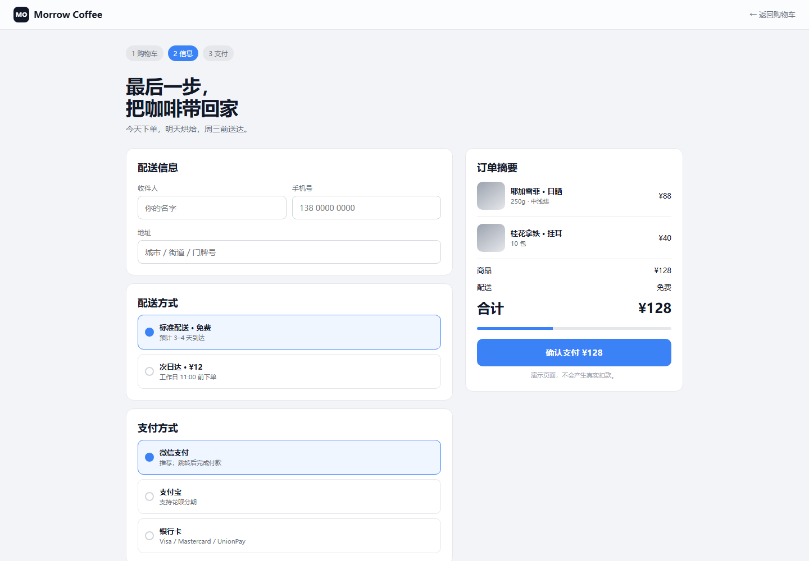
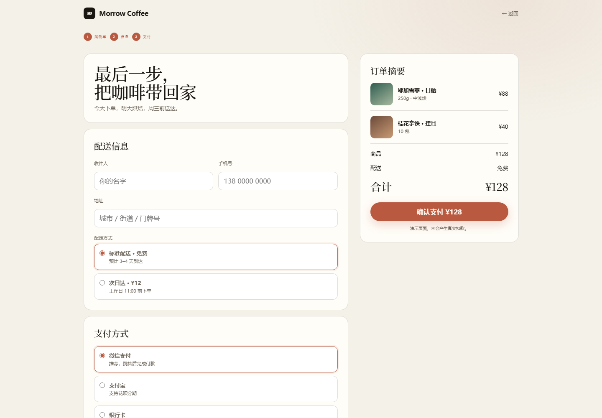
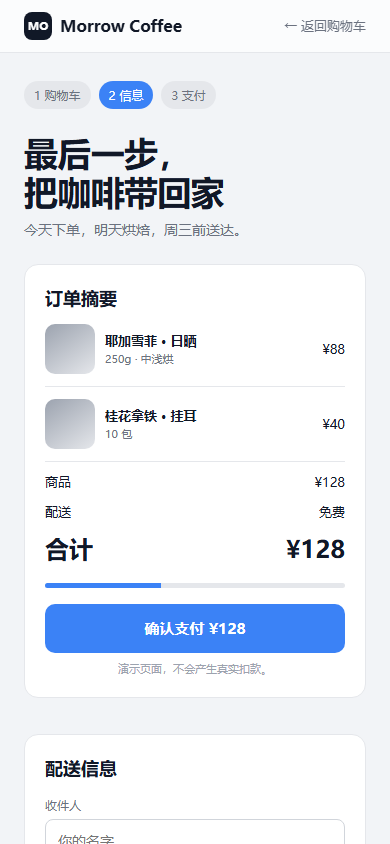
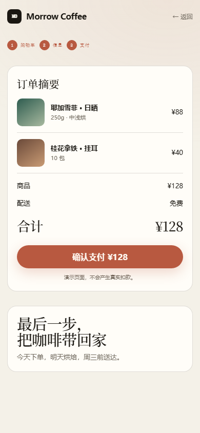

# 完整案例 · Morrow Coffee 结算流

> 同一份订单、同一套字段、同一个成功态；只改交互、表单语义、层级与质感。
> 在线试玩：https://herosann123.github.io/ui-interaction-skill/cases/morrow-coffee/

## 改造前



**体检结果：23 项**（P0 1 / P1 14 / P2 8）

| 级别 | 代表问题 |
|---|---|
| P0 | 无 `prefers-reduced-motion` |
| P1 | placeholder-only 表单、14px 输入、div onclick 选项、`touchmove` 劫持、`transition: all`、width 进度动画、无 focus-visible |
| P2 | 30px backdrop blur、`100vh`、`linear` 缓动、自绘成功 modal、无 loading/防重 |

## 改造后



**体检结果：0 项**

- 表单：真实 label、16px 输入、`:focus-visible`
- 配送/支付/小费：原生 radio + label，键盘与读屏可用
- 支付 CTA：button + loading + 防重；成功态有订单号与下一步
- 小费：0/5/10% 原生选项，不再劫持页面滚动
- 视觉：design-core editorial（奶油底、衬线标题、陶土 accent）
- 性能：删除 30px blur、`transition: all`、width 动画、`100vh`

## 手机端

| Before | After |
|---|---|
|  |  |

## 具体改了什么

| # | 改造前 | 改造后 | 模式 / 规则 |
|---|---|---|---|
| 1 | placeholder-only，输入 14px | label + aria + 16px + focus-visible | a11y/input-label · mobile/input-font-zoom |
| 2 | div onclick 选项 | `input type="radio"` + label | a11y/clickable-div |
| 3 | 可点击 div 支付，无 loading | button + loading + 防重 | 组件 8 态 |
| 4 | touchmove preventDefault 滑轨 | 原生 radio 小费选项 | mobile/touch-hijack |
| 5 | 蓝灰模板 | design-core editorial tokens | design-core |
| 6 | 30px blur / transition all / width / 100vh | 删除并交回库与浏览器 | perf/layout-animation · perf/blur-heavy |

## 为什么不是“重做一遍”

- 订单商品、价格、字段、配送/支付选项、成功文案全部保留。
- 只是把不可访问的控件换成原生控件，把视觉套进 editorial tokens。
- 只改结算流，不新增营销区块、不编造评分。

## 复现

```bash
node scripts/audit.mjs cases/morrow-coffee/before.html
node scripts/audit.mjs cases/morrow-coffee/after.html
node scripts/smoke.mjs --viewports 390,768,1280
node scripts/export.mjs --in cases/morrow-coffee/after.html --out cases/morrow-coffee/after.pdf
```

快捷键：打开 `index.html` 后按 `1` Before · `2` After · `3` Split · `D` 390px · `N` 改动说明。

## 验收

- after 体检 0 项
- 390/768/1280 + reduced-motion 烟测通过
- 表单、选项、支付、成功态均可用键盘操作
- Before / After 使用同一份订单与字段
