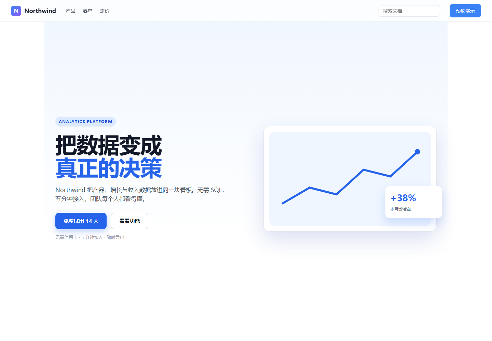
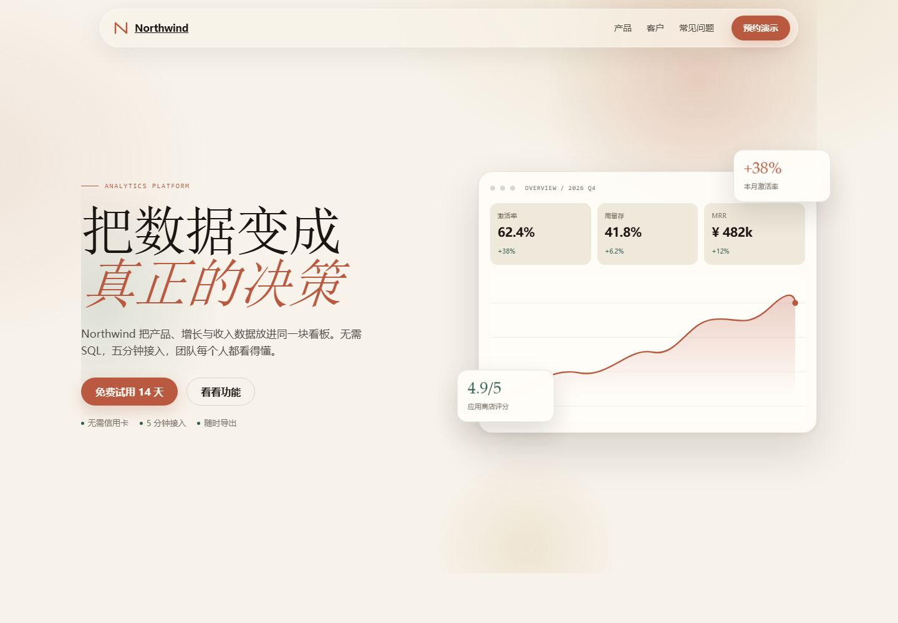

# 完整案例 · Northwind Analytics

> 同一份内容、同一套信息结构；只改交互、层级与质感。
> 在线试玩：https://herosann123.github.io/ui-interaction-skill/templates/demo-shell/

## 改造前



**体检结果：36 项**（P0 1 / P1 11 / P2 24）

| 级别 | 代表问题 |
|---|---|
| P0 | 没有任何 `prefers-reduced-motion` 降级 |
| P1 | `max-height` 手风琴、`width` 过渡、`touchmove` 劫持、无 pointercancel、图片无 alt、输入无 label、hover 倾斜无指针门控 |
| P2 | 40px backdrop blur、`transition: all`、`linear` 缓动、`setInterval` 强制轮播、`100vh`、14px 输入字号、自绘 modal、`will-change: all` |

完整报告：[`../../examples/audit-report-before.md`](../../examples/audit-report-before.md)

## 改造后



**体检结果：0 项**

- 首屏：视差 + 词级揭示 + 磁吸 CTA + 涟漪
- 特性卡：3D 倾斜 + 径向高光（仅精细指针）
- 数字：进入视口后 0→N
- 评价区：原生 scroll-snap，惯性与边界由浏览器提供
- FAQ：`<details>` + `grid-template-rows: 0fr→1fr`
- 弹窗：原生 `<dialog>`，Esc / 焦点 / 滚动锁由浏览器负责
- 全页：reduced-motion、键盘可达、390px 无溢出

## 手机端

| Before | After |
|---|---|
|  |  |

## 具体改了什么

| # | 改造前 | 改造后 | 模式 |
|---|---|---|---|
| 1 | Hero 整块 hover 倾斜，鼠标离开才复位 | 浮动指标卡分层视差；标题逐行揭示；删除整块 hover 倾斜 | ① ② ⑤ |
| 2 | 按钮只有颜色变化，`transition: all` | 磁吸（桌面）+ 涟漪 + 按压 0.96 + 触感；触摸端只用按压 | ④ ⑬ ㉜ |
| 3 | 特性卡 hover 整体位移 4px | 单卡 3D 倾斜 ±7° + 径向高光；触摸端静态 | ⑨ |
| 4 | `setInterval` 每 3 秒强制翻页 | 原生 scroll-snap 轨道；删掉定时器与手写 transform | ㉖ |
| 5 | `max-height` 猜展开高度 | 原生 `<details>` + `grid 0fr→1fr` | 53 |
| 6 | 40px blur、自绘 modal、无 reduced-motion、图片无 alt、输入 14px | 18px blur、原生 dialog、reduced-motion、可读 alt、16px 输入、`:focus-visible` | — |

## 为什么不是“重做一遍”

- Before 的文案、数据、导航、CTA、FAQ 原文全部保留。
- 只替换交互实现与表面层级；不新增客户 logo、不编造评分。
- 选中 5 个改动 + 一组基础可访问性修复，而不是把 36 项一次性堆上去。
- 取舍过程：[`../../examples/demo-brief.md`](../../examples/demo-brief.md)

## 怎么复现

```bash
# 1. 看对照壳
open templates/demo-shell/index.html      # macOS
start templates/demo-shell/index.html     # Windows

# 2. 看体检
node scripts/audit.mjs templates/demo-shell/before.html

# 3. 看 clean 页面
node scripts/audit.mjs templates/demo-shell/after.html

# 4. 浏览器烟测
node scripts/smoke.mjs
```

快捷键：`1` Before · `2` After · `3` Split · `D` 390px · `N` 改动说明。

## 验收

- `after.html` 体检 0 项
- 390px + reduced-motion 烟测：内容可见、无横向溢出、控制台 0 error
- Before / After 使用同一份内容
- 所有动效有 reduced-motion 静态版
- 弹层 / Tabs / 表单 / FAQ 可用键盘操作

> 这只是演示数据；真实项目请把 before/after 换成用户内容，并按 `DEMO.md` / `ITERATE.md` 迭代。
